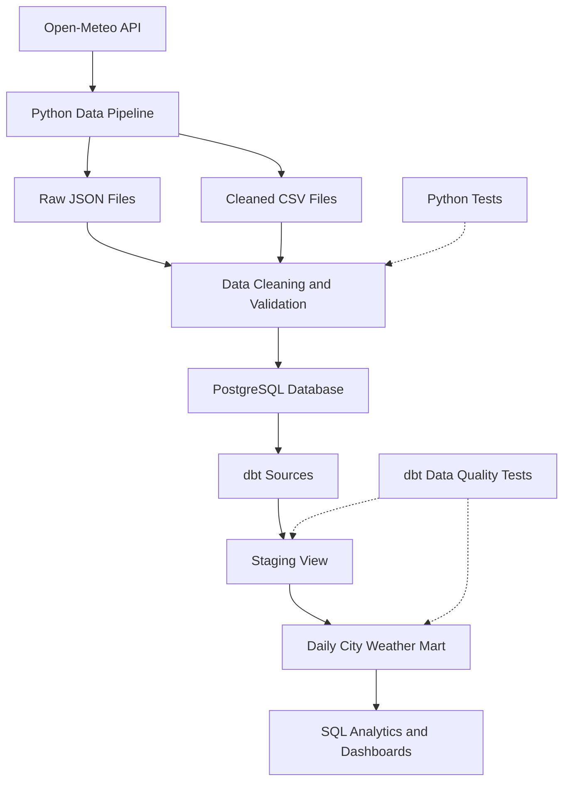
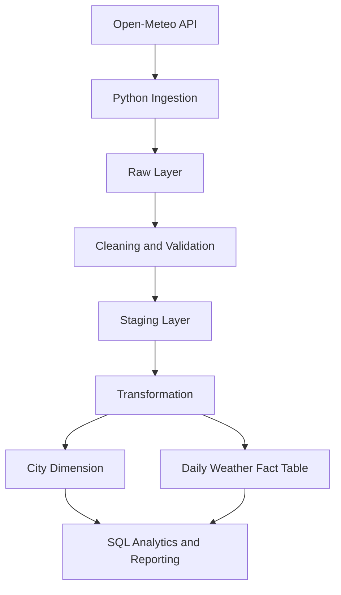

# Weather Data Engineering Pipeline

A Python ETL pipeline that fetches historical weather data from the Open-Meteo API, cleans it using Pandas, stores it in PostgreSQL, and transforms it into analytics-ready datasets using dbt.

## Project Overview

This project demonstrates an end-to-end data engineering workflow:

1. **Extract:** Fetch historical weather data from the Open-Meteo API.
2. **Transform:** Clean and validate weather data using Python and Pandas.
3. **Load:** Store weather observations in PostgreSQL.
4. **Model:** Use dbt to create staging views and analytical data marts.
5. **Test:** Run automated Python and dbt data quality tests.
6. **Analyze:** Use SQL queries and analytics-ready tables to identify weather trends.

## Architecture



### Pipeline Layers

- **Ingestion:** Python retrieves historical weather data from the Open-Meteo API.
- **Raw data:** Original API responses are saved as JSON files for traceability.
- **Processing:** Pandas cleans and validates the data and generates processed CSV files.
- **Storage:** PostgreSQL stores city information and weather observations.
- **Staging:** dbt creates the `analytics.stg_weather_observations` view by joining weather observations with city information.
- **Analytics marts:** dbt builds the `analytics.daily_city_weather` table, aggregating weather measurements by city and date.
- **Data quality:** Python tests and dbt tests help validate the pipeline and transformed data.

## Technologies Used

- Python
- Pandas
- Open-Meteo API
- PostgreSQL 18
- SQLAlchemy
- psycopg
- python-dotenv
- pytest
- dbt Core
- dbt-postgres
- SQL
- Git and GitHub

## Weather Data

The pipeline collects historical daily weather data for:

- Champaign
- Chicago
- New York

**Date range:** October 1–7, 2025

Measurements include:

- Maximum temperature (°C)
- Minimum temperature (°C)
- Precipitation (mm)
- Maximum wind speed (km/h)

The processed dataset contains 21 daily records across three cities.

## Project Structure

```text
weather-data-pipeline/
├── data/
│   ├── raw/
│   └── processed/
├── logs/
├── sql/
│   ├── schema.sql
│   ├── sample_data.sql
│   ├── analytical_queries.sql
│   └── layered_schema.sql
├── src/
│   ├── clean_weather.py
│   ├── fetch_weather.py
│   ├── load_weather.py
│   ├── main.py
│   ├── setup_database.py
│   └── update_wind_speed.py
├── tests/
│   └── test_weather_pipeline.py
├── weather_dbt/
│   ├── models/
│   │   ├── staging/
│   │   │   ├── _sources.yml
│   │   │   └── stg_weather_observations.sql
│   │   └── marts/
│   │       └── daily_city_weather.sql
│   ├── dbt_project.yml
│   └── README.md
├── .gitignore
├── .env
└── README.md
```

*Note: The structure above represents the main project files. Your local project may contain additional files.*

## Installation

### 1. Clone the Repository

```bash
git clone https://github.com/alisharawat56/weather-data-pipeline.git
cd weather-data-pipeline
```

### 2. Create a Python Virtual Environment

On Windows PowerShell:

```powershell
python -m venv .venv
.\.venv\Scripts\Activate.ps1
```

### 3. Install Python Dependencies

```powershell
python -m pip install pandas SQLAlchemy "psycopg[binary]" python-dotenv requests pytest
```

### 4. Configure Environment Variables

Create a `.env` file in the project root:

```dotenv
PGHOST=localhost
PGPORT=5432
PGDATABASE=weather_db
PGUSER=postgres
PGPASSWORD=your_local_password
```

Replace `your_local_password` with your local PostgreSQL password.

**Important:** Add `.env` to `.gitignore`. Never commit database credentials to GitHub.

### 5. Set Up PostgreSQL

Create a PostgreSQL database named `weather_db`.

If the database tables do not exist, execute `sql/schema.sql` or use the project's database setup script.

## Run the Python Pipeline

From the project root:

```powershell
python src/main.py
```

The pipeline fetches weather data, cleans and validates it, saves the processed CSV, loads observations into PostgreSQL, and logs its progress.

Output locations:

- Raw data: `data/raw/`
- Processed data: `data/processed/weather_cleaned.csv`
- Pipeline logs: `logs/pipeline.log`

## Run Python Tests

Run the automated tests:

```powershell
python -m pytest tests -v
```

The tests validate expected columns, duplicate city/date records, date ranges, and other configured data quality rules.

## dbt Transformations

The project uses dbt Core with the PostgreSQL adapter to transform stored weather observations into analytics-ready data.

### dbt Models

| Model | Materialization | Purpose |
|---|---|---|
| `stg_weather_observations` | View | Joins weather observations with city names and prepares the observation date |
| `daily_city_weather` | Table | Aggregates daily weather metrics by city and date |

The staging model reads from the existing PostgreSQL tables:

- `public.cities`
- `public.weather_observations`

The analytics models are created in the `analytics` schema.

### Run dbt

Activate the dbt virtual environment and navigate to the dbt project:

```powershell
.\.venv-dbt\Scripts\Activate.ps1
cd weather_dbt
```

If the virtual environment is already activated and you are in the project root, run only the `cd weather_dbt` command.

Check the database connection:

```powershell
dbt debug
```

Parse the project:

```powershell
dbt parse
```

Build the models:

```powershell
dbt run
```

Run data quality tests:

```powershell
dbt test
```

### dbt Data Quality Tests

The project currently includes six data tests that check:

- Observation IDs are not null.
- Observation IDs are unique.
- City IDs are not null.
- Observation dates are not null in staging.
- City IDs are not null in the daily weather mart.
- Observation dates are not null in the daily weather mart.

**Latest validation results:** Both weather models built successfully, and all six dbt tests passed.

## Query the Analytics Mart

Connect to PostgreSQL:

```powershell
psql -U postgres -h 127.0.0.1 -p 5432 -d weather_db
```

Query the daily city weather table:

```sql
SELECT *
FROM analytics.daily_city_weather
ORDER BY city_name, observation_date;
```

The analytics mart contains the following columns:

| Column | Description |
|---|---|
| `city_id` | City identifier |
| `city_name` | City name |
| `observation_date` | Date of the weather observation |
| `average_temperature_c` | Average temperature in Celsius |
| `total_precipitation_mm` | Total precipitation in millimeters |
| `max_wind_speed_kmh` | Maximum recorded wind speed in km/h |
| `observation_count` | Number of source observations included in the daily aggregate |

The latest successful query returned 21 daily city-weather records.

## Analytical SQL Queries

The file `sql/analytical_queries.sql` contains analytical queries for:

1. Average temperature by city.
2. Total precipitation by city.
3. Daily temperature trends.
4. Cities ranked by average wind speed.
5. Temperature changes between consecutive observations using `LAG()`.

Run the queries with:

```powershell
psql -U postgres -h 127.0.0.1 -p 5432 -d weather_db -f sql/analytical_queries.sql
```

## Database Design

### Cities Table

Stores city information, including city name, country, latitude, and longitude.

### Weather Observations Table

Stores weather measurements linked to each city, including observation timestamp, temperature, precipitation, and wind speed.

A uniqueness constraint on city and observation timestamp helps prevent duplicate observations.

## Layered Data Architecture

The project also includes a conceptual three-layer database design that separates raw ingestion, cleaned staging data, and analytical marts.



### Layer Responsibilities

- **Raw:** Preserves original API payloads and ingestion metadata for traceability and potential reprocessing.
- **Staging:** Standardizes dates, column names, and weather measurements, and prepares cleaned daily records.
- **Marts:** Organizes data into analytical structures for reporting and analysis.

The conceptual schemas defined in `sql/layered_schema.sql` are separate from the current dbt models, which read from the existing `public` tables and write to the `analytics` schema.

## Week 1 Checkpoint

This project demonstrates how to:

- Fetch historical data from a public API.
- Clean and validate data using Python and Pandas.
- Store structured data in PostgreSQL.
- Query data using SQL.
- Analyze consecutive temperature changes using `LAG()`.
- Build staging and analytics models with dbt.
- Run automated Python and dbt data quality tests.
- Execute the Python pipeline using a single command.

## Future Improvements

- Expand the historical date range.
- Schedule automatic pipeline runs.
- Improve API error handling and retries.
- Add more automated tests and relationship checks.
- Investigate overlapping source observations.
- Integrate dbt with the conceptual raw, staging, and marts schemas.
- Create weather visualization dashboards using Power BI or Tableau.
- Add continuous integration for automated testing.

## Author

A beginner data engineering project demonstrating API ingestion, data cleaning, ETL orchestration, PostgreSQL, dbt transformations, SQL analytics, and automated testing.
