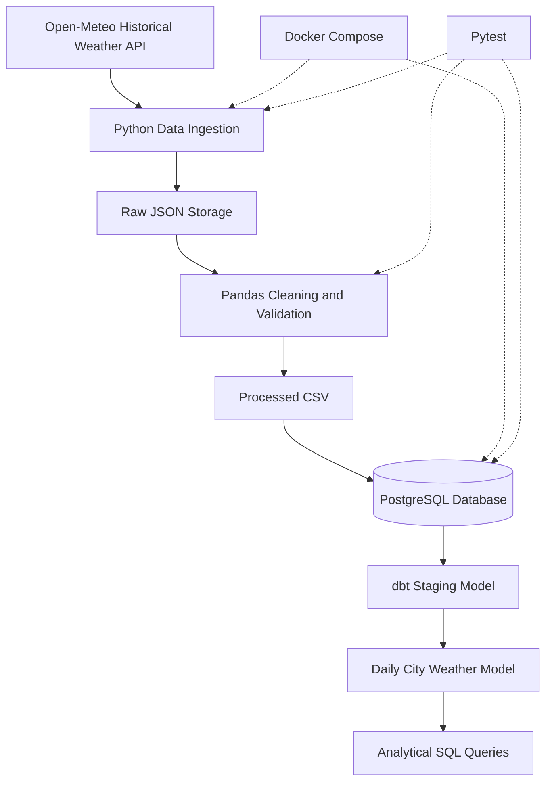
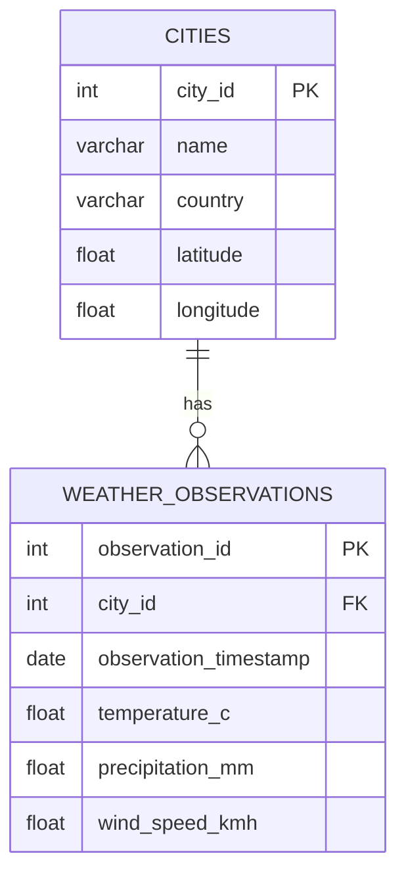
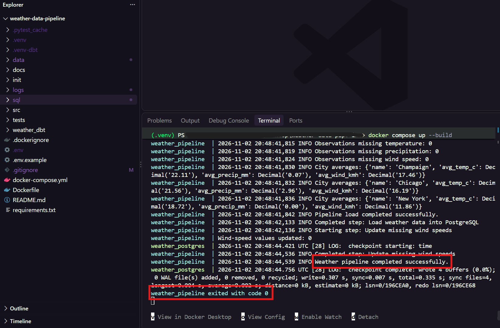
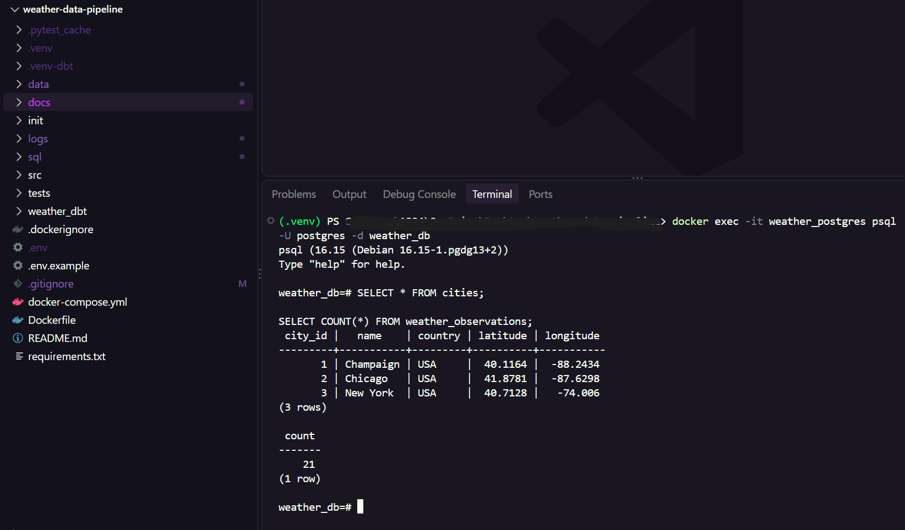
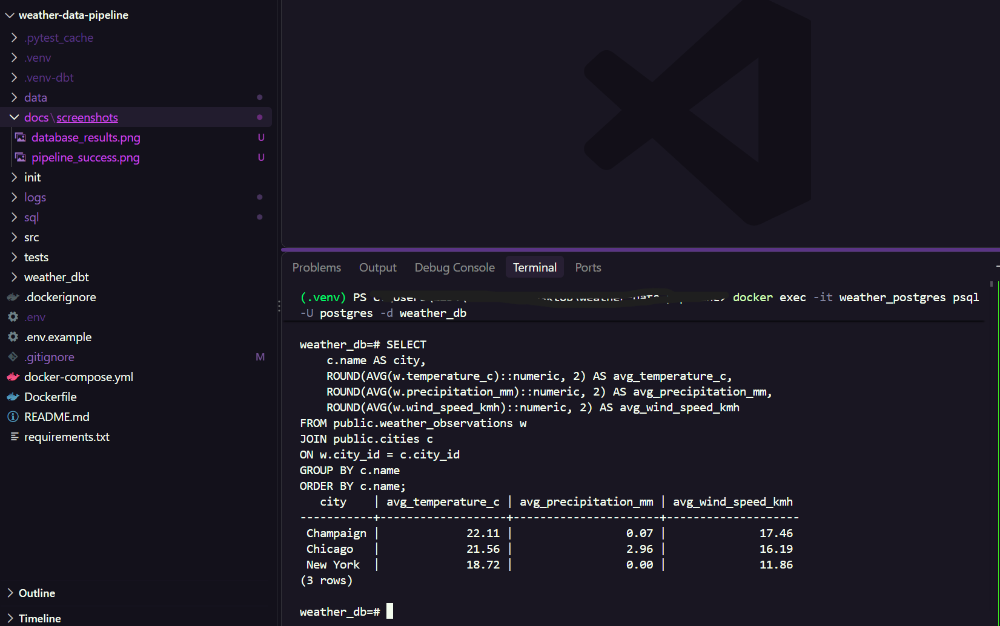
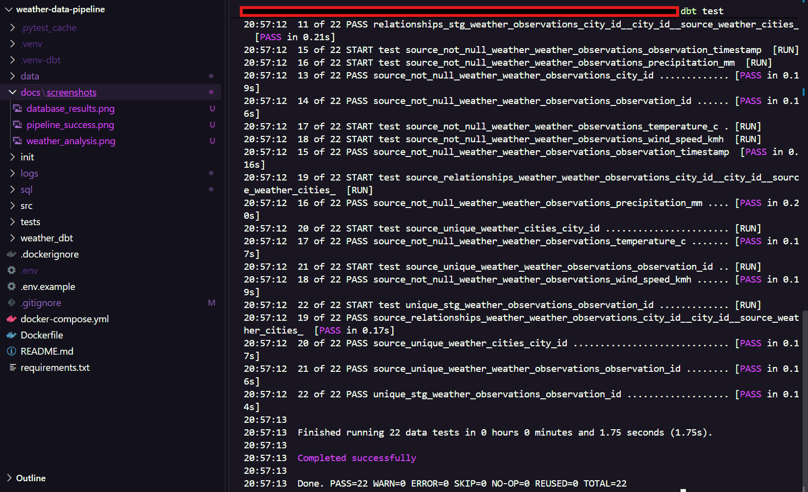

# Weather Data Engineering Pipeline

An end-to-end data engineering project that collects historical weather data from the Open-Meteo API, validates and transforms it using Python and Pandas, loads it into PostgreSQL, and builds analytical data models using dbt.

The project is containerized using Docker and Docker Compose to provide a reproducible development and execution environment.

---

## Table of Contents

1. [Project Overview](#1-project-overview)
2. [Project Objectives](#2-project-objectives)
3. [Architecture](#3-architecture)
4. [Technologies Used](#4-technologies-used)
5. [Data Source](#5-data-source)
6. [Project Structure](#6-project-structure)
7. [Data Pipeline Workflow](#7-data-pipeline-workflow)
8. [Database Schema](#8-database-schema)
9. [Getting Started](#9-getting-started)
10. [Docker Setup](#10-docker-setup)
11. [Running the Pipeline](#11-running-the-pipeline)
12. [dbt Transformations](#12-dbt-transformations)
13. [Analytical SQL Queries](#13-analytical-sql-queries)
14. [Testing](#14-testing)
15. [Screenshots](#15-screenshots)
16. [Logging and Error Handling](#16-logging-and-error-handling)
17. [Data Quality and Reliability](#17-data-quality-and-reliability)
18. [Security and Configuration](#18-security-and-configuration)
19. [Future Enhancements](#19-future-enhancements)
20. [Author](#20-author)

---

## 1. Project Overview

This project implements an automated weather data engineering pipeline that retrieves historical weather information for selected cities, processes the data, stores it in a relational database, and transforms it into analytics-ready datasets.

The pipeline demonstrates core data engineering concepts, including:

- API-based data ingestion.
- Raw data storage.
- Data cleaning and validation.
- Relational database design.
- Idempotent data loading.
- SQL-based analytical transformations.
- Automated testing.
- Docker containerization.
- Data quality validation.

### Cities Covered

- Champaign, Illinois, USA
- Chicago, Illinois, USA
- New York, New York, USA

### Data Period

October 1, 2025 – October 7, 2025.

### Main Output

A PostgreSQL database containing city information and daily weather observations, with dbt models providing an analytical layer for downstream reporting.

---

## 2. Project Objectives

The main objectives are:

1. Retrieve historical weather data from a public API.
2. Store raw API responses for traceability.
3. Clean and validate incoming weather data.
4. Load structured weather observations into PostgreSQL.
5. Prevent duplicate records during repeated pipeline executions.
6. Create analytical models using dbt.
7. Validate the pipeline using automated tests.
8. Containerize the application and database using Docker Compose.
9. Provide reproducible project setup and execution instructions.

---

## 3. Architecture

The pipeline follows a layered architecture that separates ingestion, processing, storage, transformation, and analytics.

### Architecture Diagram



### Architecture Components

| Component | Responsibility |
|---|---|
| Open-Meteo API | Historical weather data source |
| Python | Data ingestion and pipeline orchestration |
| Requests | API communication |
| Pandas | Data cleaning and validation |
| Raw JSON | Stores original API responses |
| CSV | Stores processed weather data |
| PostgreSQL | Relational data storage |
| SQLAlchemy | Database connectivity |
| dbt | SQL transformations and data testing |
| Pytest | Automated application testing |
| Docker | Application containerization |
| Docker Compose | Application and database orchestration |

---

## 4. Technologies Used

| Technology | Purpose |
|---|---|
| Python 3.12 | Pipeline development |
| Pandas | Data manipulation and cleaning |
| Requests | API ingestion |
| PostgreSQL | Relational database |
| SQLAlchemy | Database connectivity |
| Psycopg | PostgreSQL driver |
| dbt | Data transformation |
| Docker | Containerization |
| Docker Compose | Container orchestration |
| Pytest | Automated testing |
| Git | Version control |
| GitHub | Source code management |

---

## 5. Data Source

The project uses the Open-Meteo Historical Weather API.

**API Documentation:**  
https://open-meteo.com/en/docs/historical-weather-api

**API Endpoint:**

```text
https://archive-api.open-meteo.com/v1/archive
```

### Data Collected

The pipeline retrieves daily weather measurements, including:

| Field | Description | Unit |
|---|---|---|
| temperature_2m_max | Daily maximum temperature | Celsius |
| temperature_2m_min | Daily minimum temperature | Celsius |
| precipitation_sum | Daily precipitation | Millimeters |
| wind_speed_10m_max | Maximum daily wind speed | km/h |

### Geographic Coverage

| City | Country |
|---|---|
| Champaign | USA |
| Chicago | USA |
| New York | USA |

### Data Processing Period

The initial extraction covers October 1, 2025 through October 7, 2025.

The API responses are stored as raw JSON files before processing.

---

## 6. Project Structure

```text
weather-data-pipeline/
│
├── data/
│   ├── raw/
│   │   └── Original API responses
│   │
│   └── processed/
│       └── weather_cleaned.csv
│
├── docs/
│   └── screenshots/
│       ├── pipeline_success.png
│       ├── database_results.png
│       ├── weather_analysis.png
│       └── dbt_tests.png
│
├── init/
│   └── 01_schema.sql
│
├── logs/
│   └── pipeline.log
│
├── sql/
│   └── analysis_queries.sql
│
├── src/
│   ├── main.py
│   ├── clean_weather.py
│   ├── load_weather.py
│   └── update_wind_speed.py
│
├── tests/
│   ├── test_ingestion.py
│   ├── test_load_weather.py
│   └── test_weather_pipeline.py
│
├── weather_dbt/
│   ├── models/
│   │   ├── staging/
│   │   └── marts/
│   └── dbt_project.yml
│
├── .dockerignore
├── .env.example
├── .gitignore
├── Dockerfile
├── docker-compose.yml
├── requirements.txt
└── README.md
```

---

## 7. Data Pipeline Workflow

The pipeline consists of the following stages.

### Stage 1: Data Ingestion

Python retrieves historical weather data from the Open-Meteo API using HTTP requests.

The ingestion process:
- Sends API requests for each selected city.
- Retrieves daily weather measurements.
- Handles HTTP errors and request timeouts.
- Validates API response structure.
- Saves raw API responses as JSON files.

### Stage 2: Data Cleaning

Pandas processes the retrieved weather data.

Cleaning operations include:
- Flattening API responses into structured records.
- Standardizing column names.
- Converting dates into appropriate date formats.
- Converting measurements into numeric data types.
- Handling missing values.
- Removing invalid physical measurements.
- Removing duplicate city-date records.
- Sorting records by city and date.

### Stage 3: Data Storage

The cleaned weather dataset is loaded into PostgreSQL.

The database contains two primary tables:

- `cities`
- `weather_observations`

The loader uses database constraints and conflict handling to prevent duplicate observations.

### Stage 4: Data Transformation

dbt transforms the stored PostgreSQL data into analytics-ready models.

The project includes:
- `stg_weather_observations`
- `daily_city_weather`

### Stage 5: Analytics

SQL queries are used to analyze:
- Average temperature by city.
- Precipitation patterns.
- Wind speed.
- Observation counts.
- Highest recorded temperatures.

---

## 8. Database Schema

The database is named:

```text
weather_db
```

### Table 1: cities

Stores city-level geographic information.

| Column | Data Type | Description |
|---|---|---|
| city_id | SERIAL | Primary key |
| name | VARCHAR(100) | City name |
| country | VARCHAR(100) | Country |
| latitude | DOUBLE PRECISION | Latitude |
| longitude | DOUBLE PRECISION | Longitude |

A unique constraint on city name and country prevents duplicate city entries.

### Table 2: weather_observations

Stores daily weather observations associated with each city.

| Column | Data Type | Description |
|---|---|---|
| observation_id | SERIAL | Primary key |
| city_id | INTEGER | Foreign key referencing cities |
| observation_timestamp | DATE | Observation date |
| temperature_c | DOUBLE PRECISION | Estimated temperature in Celsius |
| precipitation_mm | DOUBLE PRECISION | Precipitation in millimeters |
| wind_speed_kmh | DOUBLE PRECISION | Wind speed in km/h |

A unique constraint on the combination of `city_id` and `observation_timestamp` prevents duplicate daily observations.

### Entity Relationship



### Temperature Calculation Note

The pipeline calculates `temperature_c` as the midpoint of daily maximum and minimum temperatures:

```text
temperature_c = (temperature_max_c + temperature_min_c) / 2
```

This is an estimated midpoint, not an observed daily mean temperature.

---

## 9. Getting Started

### Prerequisites

For local execution:

- Python 3.12 or later.
- PostgreSQL.
- Git.
- A terminal or PowerShell.

For containerized execution:

- Docker Desktop.
- WSL 2 on Windows.
- Docker Compose.

### Step 1: Clone the Repository

```bash
git clone https://github.com/alisharawat56/weather-data-pipeline.git

cd weather-data-pipeline
```

### Step 2: Create a Virtual Environment

Windows PowerShell:

```powershell
python -m venv .venv

.venv\Scripts\Activate.ps1
```

### Step 3: Install Dependencies

```bash
pip install -r requirements.txt
```

### Step 4: Configure PostgreSQL

Create a database named:

```sql
CREATE DATABASE weather_db;
```

Create the required tables using `init/01_schema.sql`, or use an existing database with the same schema.

### Step 5: Configure Environment Variables

Create a `.env` file in the project root.

Example:

```env
PGHOST=127.0.0.1
PGPORT=5432
PGDATABASE=weather_db
PGUSER=postgres
PGPASSWORD=your_local_password
```

Replace the example password with your local PostgreSQL password.

### Step 6: Run the Pipeline

```bash
python src/main.py
```

The pipeline will execute ingestion, cleaning, database loading, and the wind-speed update step.

---

## 10. Docker Setup

The project uses Docker Compose to run the Python application and PostgreSQL database in separate containers.

### Docker Architecture

| Container | Purpose |
|---|---|
| weather_postgres | PostgreSQL database |
| weather_pipeline | Python weather pipeline |

A persistent Docker volume stores PostgreSQL data.

### Step 1: Install Docker Desktop

Install Docker Desktop:

https://www.docker.com/products/docker-desktop/

On Windows, enable WSL 2 integration.

Verify Docker:

```powershell
docker --version

docker compose version

docker run hello-world
```

### Step 2: Create the Environment File

Copy the example configuration:

```powershell
Copy-Item .env.example .env
```

Open `.env` and configure:

```env
POSTGRES_PASSWORD=your_strong_local_password
```

Use your own password.

Do not commit `.env` to GitHub.

### Step 3: Validate Docker Compose Configuration

```powershell
docker compose config
```

This checks whether the Compose configuration can be resolved.

### Step 4: Build and Start the Containers

```powershell
docker compose up --build
```

Docker Compose will:

1. Build the Python application image.
2. Pull the PostgreSQL image if necessary.
3. Create the database container.
4. Initialize the database schema for a new database volume.
5. Wait for the PostgreSQL health check.
6. Start the Python application.
7. Execute the weather pipeline.

### Step 5: Verify Container Status

```powershell
docker compose ps -a
```

Expected status after a successful pipeline execution:

| Container | Expected Status |
|---|---|
| weather_postgres | Up (healthy) |
| weather_pipeline | Exited (0) |

The application exits after completing its one-time pipeline execution. Exit code `0` indicates successful execution.

### Step 6: View Application Logs

```powershell
docker compose logs app
```

Follow the logs:

```powershell
docker compose logs -f app
```

### Step 7: Access PostgreSQL

```powershell
docker exec -it weather_postgres psql -U postgres -d weather_db
```

List tables:

```sql
\dt
```

Check observation count:

```sql
SELECT COUNT(*) FROM weather_observations;
```

Exit PostgreSQL:

```sql
\q
```

### Step 8: Stop Containers

```powershell
docker compose down
```

This stops and removes the containers while preserving the PostgreSQL Docker volume.

To remove the database volume and its data:

```powershell
docker compose down -v
```

**Warning:** This permanently deletes the Compose-managed database data volume. Do not run it unless you intentionally want to reset the database.

---

## 11. Running the Pipeline

### Local Execution

Activate the Python virtual environment:

```powershell
.venv\Scripts\Activate.ps1
```

Run:

```powershell
python src/main.py
```

### Docker Execution

From the project root:

```powershell
docker compose up --build
```

### Verify Successful Execution

A successful run should include a message similar to:

```text
Weather pipeline completed successfully.
```

The application container should exit with code `0`.

---

## 12. dbt Transformations

The project uses dbt to organize SQL transformations and create analytics-ready datasets.

### Why dbt?

dbt separates analytical transformations from the Python ingestion process.

Python is responsible for retrieving, cleaning, and loading the data, while dbt manages SQL transformations and data quality tests.

### dbt Models

**1. stg_weather_observations**

A staging model that prepares weather observation data for downstream analysis.

**2. daily_city_weather**

An analytical model that organizes daily weather information by city.

### Run dbt

Navigate to the dbt project:

```powershell
cd weather_dbt
```

Execute transformations:

```bash
dbt run
```

Run data quality tests:

```bash
dbt test
```

Generate documentation:

```bash
dbt docs generate
```

Serve documentation locally:

```bash
dbt docs serve
```

### dbt Configuration

The dbt profile is stored outside the project in:

```text
~/.dbt/profiles.yml
```

The profile connects dbt to PostgreSQL.

For local execution, the database host is typically:

```text
127.0.0.1
```

When connecting from another container on the same Docker Compose network, use:

```text
db
```

---

## 13. Analytical SQL Queries

The project includes analytical SQL queries to explore the weather observations.

The queries are stored in:

```text
sql/analysis_queries.sql
```

### Query 1: Average Weather Measurements by City

```sql
SELECT
    c.name AS city,
    ROUND(AVG(w.temperature_c)::numeric, 2) AS avg_temperature_c,
    ROUND(AVG(w.precipitation_mm)::numeric, 2) AS avg_precipitation_mm,
    ROUND(AVG(w.wind_speed_kmh)::numeric, 2) AS avg_wind_speed_kmh
FROM public.weather_observations w
JOIN public.cities c
    ON w.city_id = c.city_id
GROUP BY c.name
ORDER BY c.name;
```

**Purpose:** Compare average temperature, precipitation, and wind speed across cities.

### Query 2: Top 10 Days with Highest Precipitation

```sql
SELECT
    c.name AS city,
    w.observation_timestamp,
    w.precipitation_mm
FROM public.weather_observations w
JOIN public.cities c
    ON w.city_id = c.city_id
ORDER BY w.precipitation_mm DESC
LIMIT 10;
```

**Purpose:** Identify the days with the highest recorded precipitation.

### Query 3: Number of Observations by City

```sql
SELECT
    c.name AS city,
    COUNT(w.observation_id) AS observation_count
FROM public.cities c
LEFT JOIN public.weather_observations w
    ON c.city_id = w.city_id
GROUP BY c.name
ORDER BY c.name;
```

**Purpose:** Check the number of stored observations for each city.

### Query 4: Highest Recorded Temperature by City

```sql
SELECT
    c.name AS city,
    MAX(w.temperature_c) AS highest_temperature_c
FROM public.weather_observations w
JOIN public.cities c
    ON w.city_id = c.city_id
GROUP BY c.name
ORDER BY highest_temperature_c DESC;
```

**Purpose:** Compare the highest estimated temperature across cities.

---

## 14. Testing

The project uses Pytest for automated testing and dbt tests for analytical data validation.

### Python Tests

Run all tests from the project root:

```bash
pytest -v
```

The test suite covers:

- API response validation.
- Required field validation.
- Weather data cleaning.
- Invalid measurement handling.
- Missing-value handling.
- Database loading.
- Duplicate prevention.
- Pipeline execution behavior.

### dbt Tests

From the dbt project directory:

```bash
dbt test
```

dbt tests validate configured properties of the transformed datasets.

### Testing Strategy

| Testing Type | Purpose |
|---|---|
| Unit Testing | Validates individual Python functions |
| Integration Testing | Checks interactions between components |
| Data Validation | Checks weather data quality |
| Database Testing | Validates loading and duplicate handling |
| dbt Testing | Validates analytical models |

---

## 15. Screenshots

Screenshots of actual project execution and results are stored in:

```text
docs/screenshots/
```

### Pipeline Execution



### PostgreSQL Database Results



### Weather Analytics



### dbt Transformations and Tests



*Screenshots should be captured from actual project execution.*

---

## 16. Logging and Error Handling

Pipeline execution logs are stored in:

```text
logs/pipeline.log
```

The logging system records:

- Pipeline execution progress.
- API ingestion status.
- Data cleaning operations.
- Database loading activity.
- Error messages.
- Successful pipeline completion.

### Error Handling

The ingestion process includes:

- Request timeouts.
- HTTP error handling.
- JSON response validation.
- Required field validation.
- Data structure validation.

If the API returns an unsuccessful response or invalid data, the pipeline reports the failure through its error-handling and logging process rather than silently treating the response as valid.

Automatic retries, exponential backoff, and alerting are potential future improvements.

---

## 17. Data Quality and Reliability

The pipeline includes several data quality checks:

- Validates API response structure.
- Checks required weather fields.
- Converts dates and measurements into appropriate data types.
- Handles missing and invalid values.
- Removes duplicate city-date records.
- Rejects negative precipitation and wind-speed values.
- Checks temperature consistency.
- Uses database uniqueness constraints.
- Uses conflict handling to prevent duplicate inserts.
- Includes automated Python and dbt tests.

### Idempotent Loading

The loader uses a unique constraint on:

```text
(city_id, observation_timestamp)
```

It also uses PostgreSQL conflict handling:

```sql
ON CONFLICT (city_id, observation_timestamp) DO NOTHING
```

This ensures that repeated pipeline executions do not create duplicate observations for the same city and date.

---

## 18. Security and Configuration

Sensitive configuration is stored outside the Docker image.

The project uses:

- `.env` for local database credentials.
- `.env.example` for a safe configuration template.
- `.gitignore` to exclude local secrets and generated files.
- `.dockerignore` to prevent unnecessary files from entering the Docker build context.

The actual `.env` file should never be committed to GitHub.

---

## 19. Future Enhancements

Potential improvements include:

- Scheduling automated ingestion using Apache Airflow.
- Adding automatic API retries and exponential backoff.
- Expanding geographic coverage to more cities.
- Supporting longer historical date ranges.
- Implementing cloud storage using AWS S3.
- Adding a cloud data warehouse.
- Building interactive dashboards using Power BI or Tableau.
- Adding pipeline monitoring and alerting.
- Implementing CI/CD using GitHub Actions.
- Adding data freshness and completeness checks.

---

## 20. Author

**Alisha Rawat**

Master's Student — Information Management  
University of Illinois Urbana-Champaign

GitHub:  
https://github.com/alisharawat56/weather-data-pipeline

---

## License

This project is intended for educational, learning, and portfolio purposes.