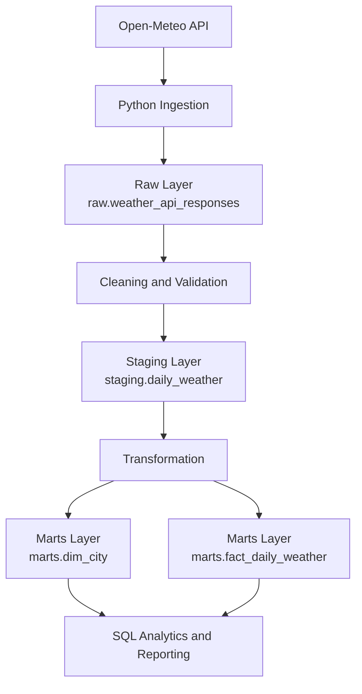

# Weather Data Engineering Pipeline

A Python ETL pipeline that fetches historical weather data from the Open-Meteo API, cleans it using Pandas, and stores it in PostgreSQL for analysis.

## Project Overview

This project demonstrates a complete data engineering workflow:

1. **Extract:** Fetch weather data from the Open-Meteo API.
2. **Transform:** Clean and validate the data using Python and Pandas.
3. **Load:** Store weather observations in PostgreSQL.
4. **Analyze:** Use SQL queries to analyze weather trends.
5. **Test:** Run automated tests to check data quality.

## Architecture

```text
Open-Meteo API
      |
      v
Python Pipeline
(Fetch, Clean, Validate)
      |
      v
PostgreSQL Database
      |
      v
SQL Analytics
```

## Technologies Used

- Python
- Pandas
- Open-Meteo API
- PostgreSQL
- SQLAlchemy
- psycopg
- python-dotenv
- pytest

## Weather Data

The pipeline collects daily historical weather data for:

- Champaign
- Chicago
- New York

**Date range:** October 1–7, 2025

Measurements include:

- Maximum temperature (°C)
- Minimum temperature (°C)
- Precipitation (mm)
- Maximum wind speed (km/h)

The dataset contains 21 daily records across three cities.

## Project Structure

```text
weather-data-pipeline/
├── data/
│   ├── raw/
│   └── processed/
├── logs/
├── sql/
│   ├── schema.sql
│   ├── sample_data.sql
│   └── analytical_queries.sql
├── src/
│   ├── clean_weather.py
│   ├── fetch_weather.py
│   ├── load_weather.py
│   ├── main.py
│   ├── setup_database.py
│   └── update_wind_speed.py
├── tests/
│   └── test_weather_pipeline.py
├── .env
├── .gitignore
└── README.md
```

## Installation

### 1. Clone the Repository

```bash
git clone https://github.com/alisharawat56/weather-data-pipeline.git
cd weather-data-pipeline
```

### 2. Create a Virtual Environment

On Windows PowerShell:

```powershell
python -m venv .venv
.\.venv\Scripts\Activate.ps1
```

### 3. Install Dependencies

```powershell
python -m pip install pandas SQLAlchemy "psycopg[binary]" python-dotenv requests pytest
```

### 4. Configure Environment Variables

Create a `.env` file in the project root:

```dotenv
PGHOST=localhost
PGPORT=5432
PGDATABASE=weather_db
PGUSER=postgres
PGPASSWORD=your_local_password
```

Replace `your_local_password` with your PostgreSQL password.

**Important:** Add `.env` to `.gitignore`. Never upload database credentials to GitHub.

### 5. Set Up the Database

Create a PostgreSQL database named `weather_db`.

If the database tables do not exist yet, execute the SQL statements in `sql/schema.sql` or use the project's database setup script.

## Run the Pipeline

From the project root, run:

```powershell
python src/main.py
```

The pipeline fetches weather data, cleans and validates it, saves the cleaned CSV, loads records into PostgreSQL, and logs its progress.

Raw data is saved in `data/raw/`.

Cleaned data is saved in `data/processed/weather_cleaned.csv`.

Pipeline logs are saved in `logs/pipeline.log`.

## Run Automated Tests

Run the tests with:

```powershell
python -m pytest tests -v
```

The tests check:

- Expected columns are present.
- Duplicate city/date records do not exist.
- Dates are valid and within the configured range.

## Analytical SQL Queries

The file `sql/analytical_queries.sql` contains five analytical queries:

1. Average temperature by city.
2. Total precipitation by city.
3. Daily temperature trends.
4. Cities ranked by average wind speed.
5. Temperature changes between consecutive observations using `LAG()`.

Run the queries using:

```powershell
psql -U postgres -h 127.0.0.1 -p 5432 -d weather_db -f sql/analytical_queries.sql
```

## Database Design

### Cities Table

Stores city information, including city name, country, latitude, and longitude.

### Weather Observations Table

Stores weather measurements linked to each city, including observation timestamp, temperature, precipitation, and wind speed.

A uniqueness constraint on city and observation timestamp helps prevent duplicate observations.


## Data Architecture

The pipeline uses a three-layer architecture to separate ingested data, cleaned data, and analytical data.



### Schema Documentation and Row Grain

| Layer / table | What one row represents | Primary key |
|---|---|---|
| `raw.weather_api_responses` | One captured API response | `ingestion_id` |
| `staging.daily_weather` | One cleaned daily observation for a city | `city_name`, `observation_date` |
| `marts.dim_city` | One distinct city | `city_id` |
| `marts.fact_daily_weather` | One city's daily analytical record | `city_id`, `observation_date` |

### Layer Responsibilities

- **Raw:** Preserves original API payloads and ingestion metadata for traceability and reprocessing.
- **Staging:** Standardizes dates, units, column names, and weather measurements. Enforces daily record uniqueness.
- **Marts:** Organizes cleaned data into a city dimension and a daily weather fact table for reporting and analysis.

### Data Flow

1. Python fetches weather data from Open-Meteo.
2. The original response is stored in the raw layer.
3. Data is cleaned and validated before being written to staging.
4. Staging data is transformed into the city dimension and daily weather fact table.
5. SQL queries use the marts layer for analysis and reporting.


## Week 1 Checkpoint

This project demonstrates how to:

- Fetch data from a public API.
- Clean and validate data using Python.
- Store structured data in PostgreSQL.
- Query data using SQL.
- Analyze consecutive temperature changes with `LAG()`.
- Run automated data-quality tests.
- Execute the pipeline using a single command.

## Future Improvements

- Expand the historical date range.
- Schedule automatic pipeline runs.
- Improve API error handling and retries.
- Add more automated tests.
- Create weather visualization dashboards.

## Author

A beginner data engineering project demonstrating API ingestion, data cleaning, ETL orchestration, PostgreSQL, SQL analytics, and automated testing.
